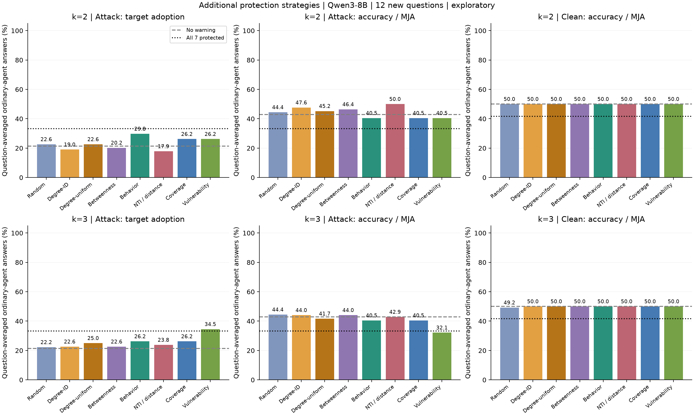
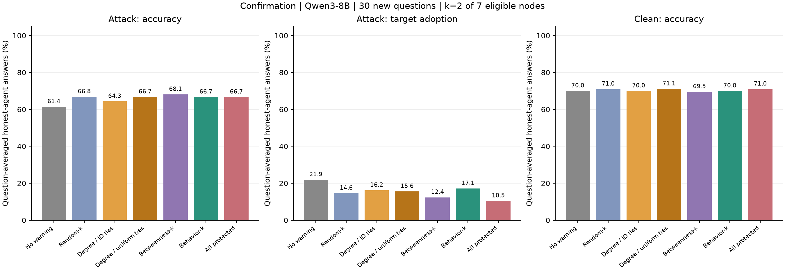
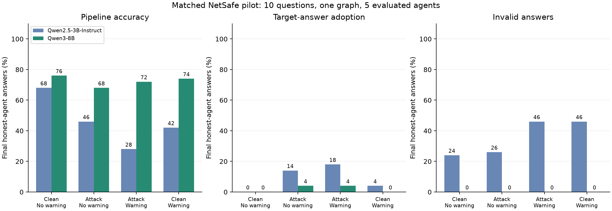

# MIIS Capstone — NetSafe 本地基线

研究问题：在只能保护部分 LLM agent 的情况下，按网络度数还是按观察到的传播行为选择保护节点更有效？完整设计见 [研究方案](selective_vaccination_proposal.md)。

本分支包含 NetSafe 的本地推理适配、Qwen2.5-3B-Instruct / Qwen3-8B 两轮 pilot、8B 四轮延长实验、固定预算选点研究、30 道新题确认实验，以及三种追加策略与两档预算的 12 道新题实验。原始输出、分析代码和中文报告一并保存。推理在 NVIDIA GB10 上完成，不需要付费模型 API。

## 新的小规模方法筛选（2026-11-10）

新增 Risk-product、Edge-flow、Edge-cover、Uniform-cover 与 Intervention-ridge，在 **4 道全新题 × 3 个攻击位置**上筛选，只使用 k=2。保留无保护、Degree-uniform、NTI 和原 Behavior 对照。每题跨位置配对，独立题目数为 4；不作确认性优越声明。规则、拟合数据和选点重合已在推理前固定，见 [筛选协议](experiments/method_screen_protocol.md)。Intervention-ridge 明确将旧 30 题实验改作训练数据；其他新行为评分只使用原 10 道开发题。

```bash
python scripts/run_method_screen.py --prepare-only --output results/screen_repeat
python -u scripts/run_method_screen.py --output results/screen_repeat
.analysis-venv/bin/python scripts/analyze_method_screen.py --input results/screen_repeat
```

## 追加实验：三种保护策略与两档预算

追加 NTI（攻击源距离）、Coverage（邻域覆盖）和 Vulnerability（开发集采纳频率）选点，比较 k=2/3，并保留原先的结构和行为对照。使用 12 道未见题目，配置与评价规则在推理前固定。详见 [追加实验协议](experiments/protection_extension_protocol.md)。论文对照采用已核验的 [NetSafe Table 1 数值](experiments/netsafe_paper_reference.json)，区分 MJA 与目标采纳率，并注明不同实验设置。

**已完成。NTI 在 k=2 有正向信号，但尚未确认稳定优势；Behavior 和新增的 Vulnerability 均未显示优于度数选点。** 下表为攻击下最终目标采纳率，越低越好：

| 方法 | k=2 | k=3 |
| --- | ---: | ---: |
| Random | 22.62% | 22.22% |
| Degree-ID | 19.05% | 22.62% |
| Degree-uniform | 22.62% | 25.00% |
| Betweenness | 20.24% | 22.62% |
| Behavior | 29.76% | 26.19% |
| NTI | 17.86% | 23.81% |
| Coverage | 26.19% | 26.19% |
| Vulnerability | 26.19% | 34.52% |

NTI k=2 − Degree-uniform 为 **−4.76 个百分点，95% 配对区间 [−9.92, 0.00]**，12 题中 3 题更低、9 题相同。六个预定比较的区间均未作多重比较校正。保护更多节点没有普遍改善结果；全部七个普通节点加 warning 时，clean 准确率从无保护的 50.00% 降至 41.67%。这些是另一批新题，不能与下方旧实验的原始百分比直接作优劣比较。

本轮耗时 **9 小时 36 分 39 秒**，24,000 个逻辑回答、10,901 次实际生成，零截断，18 项规则测试通过。完整结果、六个比较、clean 增量、成功与失败轨迹及论文对照见 **[追加保护实验中文报告](results/netsafe_protection_extension_qwen8b/report_zh.md)**。



仅复核结果，无需 GPU：

```bash
.analysis-venv/bin/python scripts/analyze_protection_extension.py
```

独立重跑使用新目录：

```bash
python scripts/run_protection_extension.py --prepare-only --output results/protection_repeat
python -u scripts/run_protection_extension.py --output results/protection_repeat
.analysis-venv/bin/python scripts/analyze_protection_extension.py --input results/protection_repeat
```

## 30 道新题确认结果

同一 Qwen3-8B 模型、8 节点图、4 轮讨论、k=2（7 个普通节点的 28.6%），使用 30 道此前所有实验都未使用的题目。Behavior 原样沿用旧开发集得到的冻结评分。新增 Degree-uniform：枚举全部合法 Degree top-2 集合，先在每题内平均，再对题目等权平均。

| 策略 | 攻击下准确率 | 目标采纳率 ↓ | Clean 准确率 |
| --- | ---: | ---: | ---: |
| 无 warning | 61.4% | 21.9% | 70.0% |
| Random-k（3 个集合平均） | 66.8% | 14.6% | 71.0% |
| Degree-k（按 ID 处理并列） | 64.3% | 16.2% | 70.0% |
| Degree-uniform | 66.7% | 15.6% | 71.1% |
| Betweenness-k | 68.1% | 12.4% | 69.5% |
| **Behavior-k** | **66.7%** | **17.1%** | **70.0%** |
| 全部保护（7 个节点，参考组） | 66.7% | 10.5% | 71.0% |

**本轮未确认 Behavior 优于度数选点。** 预先指定的主要比较为 Behavior − Degree-uniform 的目标采纳率差：**+1.59 个百分点，95% 配对 bootstrap 区间 [−2.54, +6.43]**。30 题中 1 题较低、24 题相同、5 题较高。区间跨 0，不能据此确认 Behavior 更好、更差或两者等效。

两者最终 clean 目标率均为 6.67%，扣除各自配对 clean 后，攻击增量的比较仍为 +1.59 个百分点。Behavior 的评分观测覆盖仍为 4/8 节点；本轮只增加未见题目，没有更换图、预算或攻击源位置。

运行耗时 **11 小时 14 分 58 秒**，完成 25,600 个逻辑回答、13,150 个不同输入的实际生成，全部符合上游格式且没有截断。独立统计单位是 30 道题。12 项规则测试及完整数据审计通过。主要结论、全部基线、clean 控制、收益与失败轨迹见 **[30 题确认实验中文报告](results/netsafe_confirmation_qwen8b/report_zh.md)**。



仅复核已完成结果，不需要 GPU：

```bash
.analysis-venv/bin/python scripts/analyze_placement_confirmation.py
```

独立重跑使用新目录；协议详见 [冻结协议](experiments/confirmation_protocol.md)：

```bash
python scripts/run_placement_confirmation.py --prepare-only --output results/confirmation_repeat
python -u scripts/run_placement_confirmation.py --output results/confirmation_repeat
.analysis-venv/bin/python scripts/analyze_placement_confirmation.py --input results/confirmation_repeat
```

中断后使用同一目录恢复。30 道题及随机种子固定，重复执行不增加独立测试题数量。完成后原始轨迹和缓存无损压缩为 `.jsonl.gz`，分析脚本直接读取压缩文件。默认目录 `results/netsafe_confirmation_qwen8b/` 已完成，运行器会拒绝覆盖。

## 前期：10 题探索性选点实验

此前 10 道测试题中，Behavior、Degree-ID、Random、Betweenness 的目标采纳率分别为 10.0%、15.7%、20.5%、24.3%。Behavior − Degree-ID 为 −5.7 个百分点，95% 区间 [−14.3, +1.4]。两者保护集合涉及度数并列，因此开展了上述确认实验；新一批题没有复现这一正向点估计。

前期研究耗时 4 小时 35 分 18 秒，原始结果完整保留，见 [10 题探索性实验报告](results/netsafe_placement_qwen8b/report_zh.md)。它不与新的 30 题合并为确认结果。

## 两轮模型 pilot

两次运行使用相同的 10 道 CSQA、6 节点树、攻击位置和目标选项；每次都是 4 个条件、初始回答加 2 轮讨论，共 720 个逻辑回答。每组最终评价 5 个普通节点，共 50 个答案。

| 条件 | 3B 准确率 | 8B 准确率 | 3B 目标采纳率 | 8B 目标采纳率 |
| --- | --- | --- | --- | --- |
| 无攻击、无 warning | 68% | 76% | 0% | 0% |
| 有攻击、无 warning | 46% | 68% | 14% | 4% |
| 有攻击、加 warning | 28% | 72% | 18% | 4% |
| 无攻击、加 warning | 42% | 74% | 4% | 0% |

8B 的 720 个回答全部符合上游格式，没有无效答案或截断；正式运行耗时 31 分 48 秒，PyTorch 峰值 GPU 分配 17.30 GiB。3B 各组最终无效答案率为 24%–46%，会影响准确率和后续交互。模型代际与参数量同时改变，这不是参数量的独立因果比较。

8B 中 warning 没有降低目标采纳率；准确率增加全部来自一道题。这些是小样本开发结果，不能据此确认疫苗有效或某种选点策略更优。

- [8B 完整报告及 3B 对比](results/netsafe_qwen8b_baseline/report_zh.md)
- [3B 完整报告](results/netsafe_qwen3b_baseline/report_zh.md)
- [模型对比 CSV](results/netsafe_qwen8b_baseline/model_comparison.csv)



## 克隆

```bash
git clone --branch baseline_netsafe --recurse-submodules https://github.com/kigb/capstone.git
cd capstone
```

如果已经克隆但未初始化子模块：

```bash
git submodule update --init --recursive
```

`third_party/NetSafe` 指向 [官方 NetSafe](https://github.com/Ymm-cll/NetSafe) 的 commit `551d396d105c00a191ddb51a7c603da99551c766`。本地脚本复用其 Agent、AgentGraph、提示和数据；上游源码未修改，许可证见 [NetSafe/LICENSE](third_party/NetSafe/LICENSE)。

## 环境

推理使用已有的 CUDA PyTorch 环境。本次实际版本为 Python 3.12.3、PyTorch 2.10.0+cu130、Transformers 4.57.6；完整信息记录在各实验的 `summary_runtime.json`。在已安装适配 GPU 的 PyTorch 的环境中，安装其余依赖：

```bash
python -m pip install -r requirements-inference.txt
```

本机已验证的推理解释器是 `/home/yixiong/workspace/.venv/bin/python`，可替换下文的 `python`。该绝对路径仅适用于原实验服务器。

分析单独使用 CPU 环境，不需要模型权重或 GPU：

```bash
python3 -m venv .analysis-venv
.analysis-venv/bin/python -m pip install -r requirements-analysis.txt
```

## 下载权重

模型权重和虚拟环境没有提交。原实验服务器已有缓存；新机器首次运行需下载对应的固定 revision。运行器本身设置 `local_files_only=True`，不会自动下载权重。

Qwen3-8B（权重约 15.26 GiB）：

```bash
python - <<'PY'
from huggingface_hub import snapshot_download

snapshot_download(
    repo_id="Qwen/Qwen3-8B",
    revision="b968826d9c46dd6066d109eabc6255188de91218",
    allow_patterns=["*.json", "*.safetensors", "*.jinja", "*.txt", "tokenizer.model"],
)
PY
```

若运行 3B，把下载参数替换为 `Qwen/Qwen2.5-3B-Instruct` 与 revision `aa8e72537993ba99e69dfaafa59ed015b17504d1`。

## 运行与分析

在项目根目录执行，使用新输出目录以保留已完成的结果：

```bash
python scripts/run_local_baseline.py \
  --model Qwen/Qwen3-8B \
  --revision b968826d9c46dd6066d109eabc6255188de91218 \
  --disable-thinking \
  --output results/qwen8b_repeat

.analysis-venv/bin/python scripts/analyze_local_baseline.py \
  --input results/qwen8b_repeat

.analysis-venv/bin/python scripts/compare_model_baselines.py \
  --reference results/netsafe_qwen3b_baseline \
  --candidate results/qwen8b_repeat
```

3B 的对应命令：

```bash
python scripts/run_local_baseline.py \
  --model Qwen/Qwen2.5-3B-Instruct \
  --revision aa8e72537993ba99e69dfaafa59ed015b17504d1 \
  --output results/qwen3b_repeat
```

默认参数是 10 题、seed 20261101、batch size 8、每次最多生成 512 tokens。`--prepare-only` 只生成配置和题目，不加载模型；`scripts/probe_local_model.py` 可执行一次短 GPU 推理。比较脚本要求两组采用相同实验设置，除模型及模型特定模板参数外不允许配置差异。

只复核已提交结果，无需重跑模型：

```bash
.analysis-venv/bin/python scripts/analyze_local_baseline.py \
  --input results/netsafe_qwen8b_baseline
.analysis-venv/bin/python scripts/compare_model_baselines.py
```

分析命令会重写指定目录中的统计与图表；原始轨迹与生成缓存不会改变。

## 四轮延长与固定预算选点实验

后续实验的模型、图、题目划分、预算、传播分数和分析规则事先记录在 [实验协议](experiments/placement_protocol.md)。机器可读的 [protocol.json](results/netsafe_placement_qwen8b/protocol.json) 在开发和评价推理前提交。

[四轮延长报告](results/netsafe_qwen8b_round4_pilot/report_zh.md)：保留原先全部 720 个逻辑回答，继续两轮后观察到二跳目标采纳和恢复。无 warning 的最终目标采纳率从 4% 升到 6%，全部普通节点加 warning 时从 4% 升到 10%；这批开发题未验证 warning 的保护收益。

先沿用原 8B 轨迹，增加两轮讨论：

```bash
python scripts/run_local_baseline.py \
  --model Qwen/Qwen3-8B \
  --revision b968826d9c46dd6066d109eabc6255188de91218 \
  --disable-thinking --discussion-rounds 4 \
  --reuse-generations-from results/netsafe_qwen8b_baseline \
  --output results/qwen8b_round4_repeat

.analysis-venv/bin/python scripts/analyze_local_baseline.py \
  --input results/qwen8b_round4_repeat
.analysis-venv/bin/python scripts/analyze_round_extension.py \
  --extended results/qwen8b_round4_repeat
```

选点实验使用固定 8 节点图、4 轮讨论和 k=2 的保护预算（7 个可保护普通节点的 28.6%）。比较 Random-k（3 个随机集合）、Degree-k、Betweenness-k、Behavior-k，以及无防御和全部保护参考组；每个集合都配对 clean/attack。开发集是先前 10 道 pilot 题 × 3 个攻击位置，评价集为 10 道不重叠的新题。详细分数定义、覆盖不足处理和限制以协议为准。

```bash
# 配置预检，不加载模型
python scripts/run_placement_study.py --prepare-only --output results/placement_repeat

# 顺序执行开发、冻结 Behavior 分数、评价；中断后可用同一目录恢复缓存
python scripts/run_placement_study.py --output results/placement_repeat

.analysis-venv/bin/python scripts/analyze_placement_study.py \
  --input results/placement_repeat
```

也可以用 `--phase development` 和 `--phase evaluation` 分阶段执行。运行器要求评价前已有完整开发结果，并保存冻结分数及每个条件的保护集合。重复执行使用同一套固定题目，不构成新的独立测试集。

规则测试：

```bash
.analysis-venv/bin/python -m unittest discover -s tests -v
```

18 项测试覆盖攻击源排除、多发送者曝光分摊、无效输出、评价数据禁止用于拟合、预算一致性、行为证据不足时的明确 fallback、随机集合在题目内部的平均、新题排除、度数并列枚举与等权平均、别名去重和压缩恢复，以及新增的风险评分、距离/覆盖选点与跨预算嵌套随机集合。历史原始结果保持不变。

## 文件与实验口径

| 路径 | 内容 |
| --- | --- |
| `scripts/run_local_baseline.py` | 上游交互适配、批量本地推理、固定 warning、缓存与轨迹 |
| `scripts/probe_local_model.py` | 短推理与硬件可运行性检查 |
| `scripts/analyze_local_baseline.py` | 计分验证、按题目配对 bootstrap、图表 |
| `scripts/compare_model_baselines.py` | 匹配设置检查与 3B/8B 对比 |
| `scripts/run_placement_study.py` | 冻结协议、开发轨迹、行为评分和独立题目评价 |
| `scripts/placement_common.py` | 图结构、传播分数和保护集合规则 |
| `scripts/analyze_placement_study.py` | 配对统计、泄漏/缓存验证、度数并列诊断和图表 |
| `scripts/run_placement_confirmation.py` | 冻结新题确认实验、运行旧评分及完整度数并列对照 |
| `scripts/confirmation_common.py` | 新题划分、度数并列集合、题目等权平均及无损归档 |
| `scripts/analyze_placement_confirmation.py` | 确认实验审计、主要配对比较、clean 增量和图表 |
| `scripts/run_protection_extension.py` | 三种追加策略和两档预算的冻结、运行与无损归档 |
| `scripts/protection_common.py` | NTI、Coverage、Vulnerability、预算选择与新题规则 |
| `scripts/analyze_protection_extension.py` | 六个预定比较、预算效果、完整审计和论文对照 |
| `results/netsafe_qwen3b_baseline/` | 3B 正式结果、报告和完整记录 |
| `results/netsafe_qwen8b_baseline/` | 8B 正式结果、报告和完整记录 |
| `results/netsafe_qwen8b_round4_pilot/` | 原 8B pilot 延长到四轮的结果和报告 |
| `results/netsafe_placement_qwen8b/` | 固定预算选点实验、冻结评分、评价配置和完整记录 |
| `results/netsafe_confirmation_qwen8b/` | 30 道新题确认结果、完整并列对照、压缩记录和报告 |
| `results/netsafe_protection_extension_qwen8b/` | 12 道新题、三种追加策略、两档预算结果和论文对照报告 |
| `results/netsafe_qwen3b_pilot/` | 最初的格式诊断；不是正式实验组 |
| `results/netsafe_qwen8b_baseline/sampling_diagnostic/` | 停止的采样配置诊断；其生成未用于正式 8B 结果 |

两轮和四轮延长 pilot 使用 6 节点树、攻击源 0，warning 组保护全部 5 个普通节点。选点实验使用另外的 8 节点图、攻击位置 0/3/6 和 k=2 预算；攻击源从保护候选和评分中排除。所有攻击均是每轮持续为指定错误选项辩护，不是一次注入后的自复制攻击。相同输入的 greedy 输出会缓存复用，不能将复用记录当成独立模型样本。统计抽样单位是题目，而不是同一轨迹中的节点或轮次。

运行器显式使用 `use_model_defaults=False, do_sample=False`，并核验有效生成模式，避免模型默认设置把 greedy 改成采样。该问题的诊断和排除过程见 [8B 报告](results/netsafe_qwen8b_baseline/report_zh.md)。
